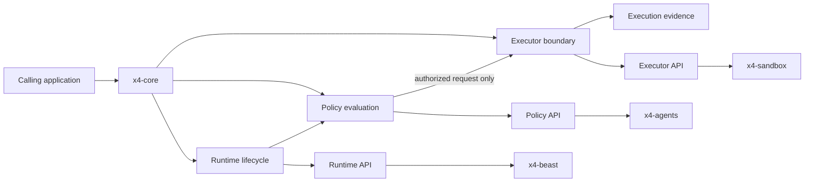

# x4-core

**Core runtime and shared infrastructure for the X4 open-source ecosystem.**

Config • Logging • Events • Telemetry • Auth • Permissions • Plugins • Schemas

[](LICENSE)
[](CHANGELOG.md)

Part of **[ARIEX4Ops / X4](https://github.com/dhe-cruzer69)** — secure AI agents, automation, and developer infrastructure.

---

## Why x4-core exists

Higher-level projects (agents, memory, sandbox, MCP) should not re-implement configuration, logging, events, or permission checks. x4-core provides the stable, typed, observable foundation they all share.

## Installation

```bash
pip install x4-core
# or for development
pip install -e ".[dev]"
```

## 60-second example

```python
from x4.core import Config, Logger, EventBus, Permission

config = Config.load()
logger = Logger("x4")
events = EventBus()

logger.info("x4-core started", version="0.1.0")
events.emit("runtime.ready", {"version": "0.1.0"})

allowed = Permission.check(
    actor="agent",
    action="filesystem.write",
    resource="./workspace"
)
print("Write allowed:", allowed)
```

## Architecture

## APEX Architecture Map

> Status: architecture documentation; implementation and deployment claims require independent verification.


**Evidence note:** This is an architecture map to verify against exported symbols and tests; arrows indicate intended integration boundaries, not proof of shipped functionality.


See [ARCHITECTURE.md](ARCHITECTURE.md).

```
x4-core
├── packages/
│   ├── config/
│   ├── logger/
│   ├── errors/
│   ├── events/
│   ├── telemetry/
│   ├── auth/
│   ├── permissions/
│   ├── plugins/
│   └── runtime/
├── schemas/
├── adapters/
├── tests/
├── examples/
└── docs/
```

## Related projects

| Project | Role |
|---------|------|
| [x4-agents](https://github.com/dhe-cruzer69/x4-agents) | Flagship secure multi-agent runtime |
| [x4-ai](https://github.com/dhe-cruzer69/x4-ai) | Provider-agnostic AI layer |
| [x4-memory](https://github.com/dhe-cruzer69/x4-memory) | Local-first agent memory |
| [x4-sandbox](https://github.com/dhe-cruzer69/x4-sandbox) | Sandboxed tool execution |
| [x4-mcp-gateway](https://github.com/dhe-cruzer69/x4-mcp-gateway) | Policy-controlled MCP gateway |
| [x4-research](https://github.com/dhe-cruzer69/x4-research) | Evidence-first research engine |

## Security

See [SECURITY.md](SECURITY.md). Report vulnerabilities privately.

## Contributing

See [CONTRIBUTING.md](CONTRIBUTING.md) and [CODE_OF_CONDUCT.md](CODE_OF_CONDUCT.md).

## Roadmap

See [ROADMAP.md](ROADMAP.md).

## License

Apache-2.0 — see [LICENSE](LICENSE).

## Support

If x4-core or the wider X4 ecosystem is useful to you, consider supporting continued development:

**[GitHub Sponsors → dhe-cruzer69](https://github.com/sponsors/dhe-cruzer69)**
